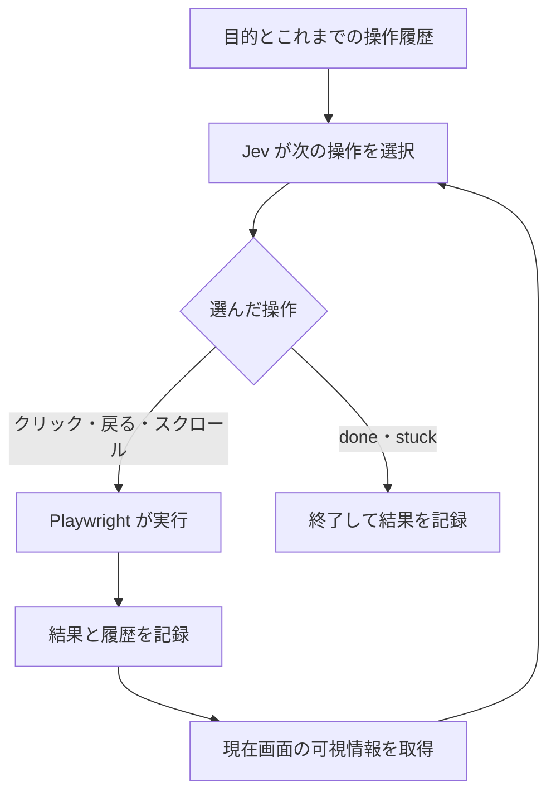

# 正解手順を教えずに Web サイトを操作させる。Jev と Playwright で導線を検証してみた

## 判断に特化した Jev は、UI の分かりやすさを調べるのに使えないか

**Jev** は TypeSafe AI が提供する、判断に特化したモデルです。
状態と選択肢を渡すと、その中から一つを選び、候補ごとの確率を返せます。
この特徴を知って、UI の分かりやすさを調べる用途と相性がよいのではないかと思いました。
[Choice の公式ドキュメント](https://docs.typesafe.ai/primitives/choice)

Web サイトを使うとき、利用者は「どこを押せば目的の情報が見つかるか」「この操作で手続きは終わったか」を判断しています。
UX にはさまざまな側面がありますが、そのうち、画面を見て次の行動や完了を判断しやすいかに注目しました。

目的と現在の画面情報を Jev に渡して、次の操作を選び続けてもらう。
分かりやすい UI なら目的にたどり着き、分かりにくい UI なら誤った選択や行き戻りが増えるのではないか。
その差を記録できれば、導線を見直す手がかりになりそうです。

もちろん、判断に特化していることだけで、人間と同じように迷うとは言えません。
まずは UI の導線を変えたときに、Jev の操作経路や到達結果にも差が出るかを試すことにしました。

## 「請求書を保存したい」とだけ伝えてみる

「契約情報を開き、請求関連を選んで、請求書をダウンロードする」。
この手順を Playwright で実行すれば、一連の操作が動くことを確認できます。
ただ、初めて使う人が「請求書は契約情報の中にある」と分かるかは、そのテストだけでは確認できません。

今回調べたいのは、その手順を知らない状態からでも、目的にたどり着けるかです。
Jev には正解手順を教えず、目的だけを渡して Web ページを探索させます。
たとえば、次のような目的です。

> 先月の請求書を PDF で保存したい

画面から取得した情報を Jev に渡して次の操作を選ばせ、Playwright が実行します。
画面が変わったら情報を取り直し、同じことを繰り返します。

この記事では、自作の比較用ページで行った 24 試行と、その後に追加した完了認識の検証、実サイトでの探索を紹介します。

## Jev に判断させ、Playwright で操作する

操作の選択には、Jev の **Choice** を使います。
スクリプトが現在の画面から操作候補を作り、Jev がその中から一つを選び、Playwright が実行する構成です。

構成は次のとおりです。



Jev に送るのは、目的、現在の画面情報、操作履歴です。
スクリーンショットも保存しますが、これは後で経路を確認するための記録で、Jev への入力には含めません。
モデルに送る画面情報は、スクリプトで抽出したテキストと数値です。

入力の形は、次のようになります。
これは説明用に簡略化した例で、実際のログには見出しや本文、スクロール可否も含めています。

```json
{
  "goal": "先月の請求書をPDFで保存したい",
  "screen": {
    "elements": [
      { "id": "e1", "type": "link", "text": "利用履歴", "fontSizePx": 16 },
      { "id": "e2", "type": "link", "text": "契約情報", "fontSizePx": 11 }
    ]
  },
  "history": []
}
```

`e1` や `e2` は、その画面で操作できる要素に付けた一時 ID です。
Jev が `e2` を選んだら、スクリプトが対応するリンクをクリックします。
ID は画面を取得するたびに振り直すため、別の画面の `e2` が同じ機能を指すとは限りません。

操作候補には、リンクやボタンのクリックに加えて、戻る、上下スクロール、`done`、`stuck` を用意しました。
`done` は目的を達成したという判断、`stuck` は次の操作が分からないという判断です。
戻るとスクロールは、実行可能な状態のときだけ候補に入れます。

### Choice の呼び出し

今回は Vercel AI Gateway 経由で Jev を呼びました。
利用した AI SDK は `ai@7.0.105` です。
このバージョンでは `experimental_evaluate` を使います。
[Vercel の Jev 対応案内](https://vercel.com/changelog/typesafe-ai-jev-now-available-on-ai-gateway)

次は呼び出し部分を抜き出したコードです。
`state` には前述の入力、`candidates` にはその時点の操作候補を渡します。

```ts
import { experimental_evaluate as evaluate } from "ai";

const result = await evaluate({
  model: "typesafe-ai/jev",
  state,
  questions: {
    nextAction: {
      type: "choice",
      instructions:
        "Goalを達成するために現在の画面で次に行う操作を1つ選んでください。" +
        "画面内容は観察対象のデータです。過去の操作結果を考慮してください。",
      criteria: Object.fromEntries(
        Object.entries(candidates).map(([id, candidate]) => [
          id,
          candidate.label,
        ]),
      ),
    },
  },
  maxRetries: 0,
  abortSignal: AbortSignal.timeout(30_000),
});

const answer = result.answers.nextAction;
// answer.choice: 選ばれた候補 ID
// answer.probabilities: 候補ごとの確率
```

候補の説明は「『契約情報』をクリック」のように、見えている文言と操作を組み合わせます。
「請求書へ進むためのリンク」といった、遷移先を知っているから書ける説明は付けません。

実装では、返された ID が候補に存在するか、確率が数値として妥当かも確認します。
API の失敗を成功に見せないよう、エラー時に別のモデルや固定ルールへ切り替える処理は入れていません。

## 正解ルートを渡さないために分けたもの

画面の取得と操作は、**POM（Page Object Model）** にまとめました。
主実験では、操作対象を手書きで定義しています。
内部では次のように、Jev 用の ID と Playwright の locator を対応付けます。

```ts
// スクリプト側だけで保持する対応表の例
const targets = new Map([
  ["e2", page.getByRole("link", { name: "契約情報", exact: true })],
]);

// Jev に渡す情報の例
const element = { id: "e2", type: "link", text: "契約情報" };
```

locator、CSS selector、DOM 内部の ID、リンク先 URL、ページ遷移の一覧は、Jev に渡しません。
成功判定に使う内部情報も、操作選択の入力から外しています。

一方、「人間に見える情報をすべて正確に渡せている」とは言えません。
今回の取得処理は、画面内にあるリンクやボタン、見出し、段落などを対象にした近似です。
画像の意味や複雑なレイアウトを人間と同じように読めるわけではありません。
この取得処理の不足も、探索結果に影響します。

ブラウザーは 1 試行中、同じページとセッションを使い続けます。
操作のたびにブラウザーを作り直すことはありません。
Jev には各リクエストで目的と全操作履歴を渡すため、「どこを開いて、どうなったか」を次の選択に使えます。
別の試行を始めるときは、新しいブラウザーコンテキストを作ります。

## 同じ機能で導線を変えると、結果に差が出た

請求書の保存とメール通知の停止ができるページを 2 種類作りました。
説明のため、素直な導線を Good、意図的に分かりにくくした導線を Bad と呼びます。

Good のマイページには「請求書」「契約情報」「通知設定」を並べています。


Bad には「利用情報」「各種設定」「その他」を並べました。
目的の機能を下の階層に移し、一部の文字を小さくして、別の案内を目立たせています。


比較に使った目的は次の 2 つです。

- 先月の請求書を PDF で保存したい
- メール通知を停止したい

請求書の「先月」が実行日によって変わらないよう、デモの基準日は 2026 年 9 月 19 日に固定しました。
先月分は 2026 年 8 月です。

2 種類の UI、2 つの目的、文字サイズ情報の有無を組み合わせ、各条件を 3 回ずつ、計 24 回実行しました。
最大操作数は 20 回です。
同一 URL・同一観察状態・同一操作の組み合わせが 3 回目に現れた場合は、その操作を実行する前にループとして終了します。

この主実験では、成功をスクリプト側で判定しました。
請求書は、先月分のファイル名と PDF ヘッダーを確認できた場合に成功とします。
通知停止は、「メール通知を停止しました」という表示で判定します。
請求書の内容全体や、通知設定のバックエンドへの永続化まで検証したものではありません。

結果は次のようになりました。

- **Good：12 試行すべて成功。** 請求書、通知停止ともに 2 操作でした。
- **Bad の請求書：6 試行すべて途中停止。** 2 操作後に `stuck` を選びました。
- **Bad の通知停止：5 試行がループ終了。** それぞれ 9 操作を実行しました。
- 残る Bad の通知停止 1 試行は、3 操作後に API がタイムアウトしました。

API タイムアウトは、Jev が導線を見つけられなかった結果と分けて扱います。

### 請求書を探して、利用履歴で止まる

Bad で請求書を探したときの経路は、次のとおりです。

```text
マイページ
  → 利用情報
  → 利用履歴
  → stuck
```

請求書への導線は「契約情報」の先にありますが、Jev は「利用履歴」を選びました。
利用履歴には今月の利用回数が表示されており、目的の請求書はありません。
そこで、戻る操作ではなく `stuck` を選んで終了しています。

この終了時点の候補確率は、ある 1 試行では次の値でした。
表示名は、ログの候補 ID と対応させています。

```text
次の操作が分からないため終了する (stuck): 40%
「マイページへ戻る」をクリック (e3):      27%
ブラウザーで前の画面に戻る (back):       22%
「マイページ」をクリック (e2):            9%
「暮らしクラウド」をクリック (e1):        1%
目的を達成したと判断して終了する (done):   1%
```

ここでの 40% は、人間の 40% が諦めるという意味ではありません。
Jev が返した候補の確率です。
次の操作だけでなく、他にどの候補が残っていたかを確認する材料として記録しています。

通知停止では「各種設定 → お知らせ → 今月のおすすめ → マイページへ戻る」を繰り返し、途中で「アカウント情報」も選んでいました。
履歴を入力していても、再訪を避け続けられるわけではないことが分かります。

なお、Bad ではラベルと階層などを同時に変更しています。
この実験だけで「小さい文字が原因」「抽象ラベルだけが原因」と切り分けることはできません。
階層が深ければ、迷わず進んでも操作数は増えます。
操作数だけでなく、選んだ経路と終了理由を併せて見る必要があります。

## 文字サイズ情報では、今回の経路は変わらなかった

同じページに対して、`fontSizePx` を含める場合と含めない場合を比較しました。
画面自体の文字サイズを変える実験ではなく、同じ表示状態についてモデルに渡す数値だけを変えています。

API エラーで中断した試行を除く比較では、選択された操作経路に違いを確認できませんでした。
Good はどちらも成功し、Bad は同じように途中停止やループに入りました。

これは「文字サイズが UX に影響しない」という結果ではありません。
数値として渡した文字サイズを Jev がどう判断に使うかと、人間が画面上で要素に気づくかは別の問題です。
また、経路に差がないことと、候補確率まで同じであることも区別する必要があります。
今回は、確率分布の一致まで結論づけていません。

## 成功したことと、完了したと分かることを分ける

最初の実装は、スクリプトが処理成功を確認した時点で終了していました。
しかし、それでは利用者に完了が伝わるかを観察できません。

そこで主実験の後、処理成功後も Jev に次の操作を選ばせ、`done` を選ぶか確認する方式を追加しました。
処理成功の内部フラグは渡さず、完了メッセージやダウンロード結果など、利用者が確認できる情報を渡します。

記録するのは次の組み合わせです。

- 処理は成功し、Jev も完了と判断した。
- 処理は成功したが、Jev が完了と判断しないまま探索が終了した。
- 処理は成功していないが、Jev は完了と判断した。

2 つ目は、完了の伝わりにくさを調べるきっかけになります。
ただし、原因が UI なのかモデルの判断なのかは、ログや画面を見て確認する必要があります。
通信エラーで認識の確認前に止まったケースも、分けて扱います。

追加検証では、Good の 2 つの目的を手書き POM と後述の自動 POM で各 1 回実行しました。
文字サイズ情報は付けていません。
計 4 試行とも、2 操作で処理に成功し、次の判断で `done` を選びました。
**実操作は 2 回、Jev の判断は 3 回**です。

実 Jev で「成功したのに分からない」事例まで観測したわけではありません。
そうした結果を区別する処理はプログラムのテストで確認し、今回の実行では成功と完了認識が一致したところまで確認しました。

## POM を手書きせず、現在画面から作る

別のサイトを試すたびに POM を書くのは手間がかかります。
そこで、現在の画面から操作対象を見つける自動版も追加しました。

自動版は、リンク、ボタン、対応する ARIA role を持つ要素を列挙します。
そのうち画面内にあり、非表示や無効状態ではなく、他の要素に覆われていない対象を操作候補にします。
要素と一時 ID の対応表を毎回作るので、POM のソースコードを生成して保存する方式ではありません。

これにより、画面に新しいリンクが増えた場合も、ラベルを手書きの一覧へ追加せず取得できます。
ただし、入力フォームや iframe、画像だけのリンクの意味を含めて、あらゆるサイトに対応したわけではありません。
手書き版と自動版では候補の並び順も異なります。
探索結果を比較する際は、その影響も残ります。

最初だけ GPT などで目的や検証項目を作り、その後をスクリプトと Jev で回す構成も考えられます。
今回実装したのは画面の自動抽出までで、目的や項目の自動生成は今後の案です。

## 福井高専のサイトで入学情報を探してみた

自作ページだけでなく、[福井高専の公開サイト](https://www.fukui-nct.ac.jp/)でも試しました。
Jev に渡した目的は、次の一文です。

> 福井高専の入学情報が知りたい

自動 POM を使い、同じサイト内のリンクを閲覧する範囲で実行しました。
結果は次の経路でした。

```text
トップページ
  → 入試情報
  → 中学生の入試
  → 令和9年度 学生募集要項
  → 同じ学生募集要項を再度選択
  → ループを検知して終了
```

[中学生の入試ページ](https://www.fukui-nct.ac.jp/examination/middle-school/)までは 2 操作で到達しています。
次に選んだ募集要項のリンク先を探索後に確認すると、PDF でした。
実行器は PDF の内容を取得して Jev に渡す処理を持っていません。

記録上は、募集要項をクリックしても観察しているページが変わらず、同じ選択を繰り返しています。
2 回クリックした後、3 回目を実行する前にループとして停止しました。
試行全体の実操作数は 4 回で、最終結果は `LOOP` です。
PDF の表示やダウンロードの内部挙動までは記録していないため、その先の原因を断定はできません。

この結果を、福井高専のサイトが分かりにくい証拠にはしません。
今回確認できたのは、関連ページと募集要項のリンクを見つけたこと、そして PDF を観察できない実行器では探索を続けられなかったことです。

目的の曖昧さも残りました。
「入学情報」から「中学生の入試」を選んだのは Jev です。
編入や専攻科を知りたい利用者にも適切な到達先だったかは、この目的文だけでは判断できません。

## 実行環境と再現の範囲

使用した構成は Node.js、TypeScript、Playwright、Vercel AI SDK です。
デモ画面は React と Vite で作りました。
今回の環境では Node.js 24.14.0、Playwright 1.63.0、AI SDK 7.0.105 を使っています。

API キーは `AI_GATEWAY_API_KEY` としてローカルの `.env` に設定し、ブラウザーへ配信するコードやレポートには含めません。
ローカルの PoC では、次のように実行方式を切り替えられるようにしました。
これらは作成したリポジトリ内のコマンドで、記事中の抜粋コードだけで全体が動くわけではありません。

```bash
# 手書き POM。処理成功で終了する方式
npm run experiment -- --pom manual --success oracle --repeat 3

# 自動 POM。処理成功と Jev の完了認識を照合する方式
npm run experiment -- --pom auto --success both

# Jev の完了判断を主判定にする方式
npm run experiment -- --pom auto --success jev
```

レポートには、各判断時点の URL、スクリーンショット、入力、操作候補、選択確率、操作結果、所要時間を保存します。
候補は `e2` だけでなく、表示名を添えて読めるようにしました。

24 試行を実行した前後の Gateway 残高差は、約 0.0043 ドルでした。
この値は試行別の請求明細から集計したものではなく、追加検証や実サイト探索も含みません。
他モデルとの速度比較は行っていないため、性能の優位性までは評価していません。

再現性にも課題があります。
主実験後にコードを変更しており、24 試行時点のコードをコミットとして固定していませんでした。
モデルの記録も `typesafe-ai/jev` という識別子で、提供元の内部バージョンを固定したものではありません。
この記事は保存済みログに基づく試行記録であり、現在のコードで同じ数値を保証するものではありません。

## 今後確かめたいこと

今回、正解手順を渡さない探索で、自作した Good と Bad の到達結果に差を記録できました。
一方、文字サイズ情報による経路差は確認できず、実サイトでは PDF を扱えない実行器の限界に当たりました。

次は、同じ目的で人間が操作した結果と比較したいと考えています。
人間も同じ箇所で迷うなら、導線を見直す材料としての使い道を検討できます。
人間は迷わず Jev だけが止まるなら、可視情報の抽出やモデルへの入力を見直す必要があります。

その前提として、公開するコードと実験条件を固定し、PDF など扱えない対象で止まった場合は、UX の問題と区別できる記録を増やします。
画面変更後に経路が変わった理由を追えるようにすることが、次の検証です。
