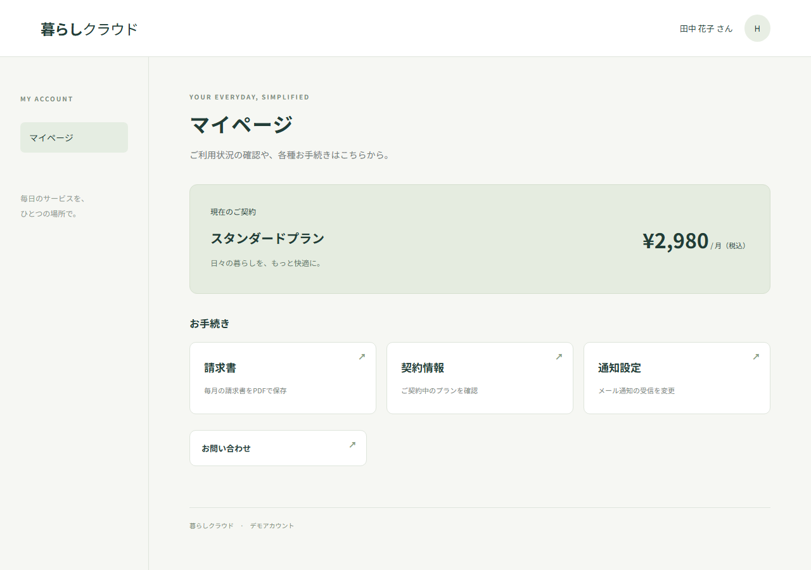
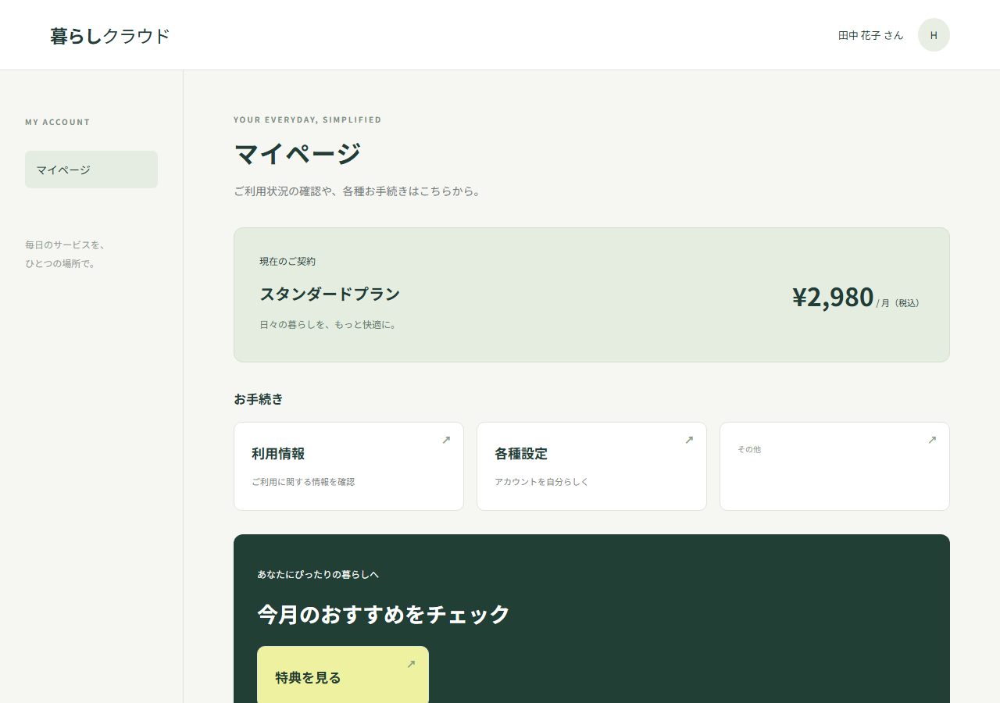
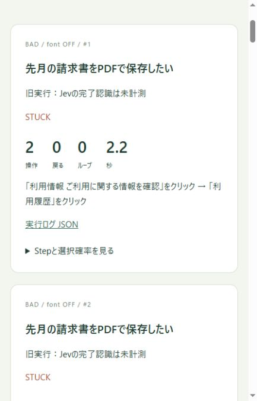
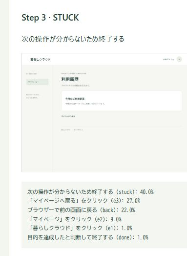

# 判断特化AI「Jev」はUX検証に使える？ 正解手順なしでWebサイトを探索させてみた

Jev は、文章の生成ではなく判断に特化した AI モデルです。
現在の状態と選択肢を渡して、その中から一つを選ばせることができます。
[Jev の公式ドキュメント](https://docs.typesafe.ai/introduction)

これを知って、Web サイトの UX 検証と相性がよさそうだと思いました。
サイトを使う人も「どこを押せばいいか」「これで手続きが終わったか」を判断しているからです。
UX のすべてではありませんが、この判断のしやすさなら検証できそうです。

そこで、Jev に目的と画面情報を渡し、正解手順を教えずにサイトを操作させてみました。
自作ページで 24 回試したところ、素直な導線では 12 回すべて成功し、分かりにくくした導線では途中停止やループが起きました。
ただし、これだけで人間にとっての使いやすさを測れたとは言えません。

## 「請求書を保存したい」だけでたどり着けるか

操作手順を指定する E2E テストなら、「契約情報 → 請求関連 → ダウンロード」が動くことを確認できます。
でも、初めて使う人が「請求書は契約情報の中にある」と分かるかは別の話です。

今回 Jev に渡すのは、次のような目的です。

> 先月の請求書を PDF で保存したい

役割はシンプルで、**Jev が次の操作を選び、Playwright が実行**します。

```text
画面の情報を取得 → Jev が操作を選択 → Playwright が実行
       ↑                                  │
       └──────── 操作結果と履歴を追加 ──────┘
```

Jev に渡すのは、目的、画面内の文言や操作候補、これまでの操作履歴です。
リンク先 URL やセレクター、正解ルート、成功判定の内部フラグは渡しません。
スクリーンショットは記録用で、Jev が画像を見て操作する構成ではありません。

候補にはクリックやスクロールのほか、「完了した（done）」「次の操作が分からない（stuck）」も用意しました。
操作のたびに情報を取り直しますが、ブラウザーのセッションは同じ試行中ずっと維持します。

## 導線を変えると、たどり着けなくなった

同じ機能を持つ、2 種類のマイページを用意しました。
Good は「請求書」「通知設定」が見える画面です。



Bad は「利用情報」「各種設定」「その他」といった抽象的な名前にし、目的の機能を下の階層へ移しました。
一部の文字を小さくし、別の案内も目立たせています。



目的は「先月の請求書を保存」「メール通知を停止」の 2 つ。
UI 2 種類 × 目的 2 種類 × 文字サイズ情報の有無 × 各 3 回で、計 24 試行です。
この比較では、成功はスクリプト側で判定しました。

- **Good：12 回すべて成功。どちらの目的も 2 操作で完了。**
- Bad の請求書：6 回すべて、2 操作後に `stuck`。
- Bad の通知停止：5 回が 9 操作後にループ終了。
- 残る 1 回は、3 操作後に API タイムアウト。導線の失敗とは分けて扱います。

Bad で請求書を探した経路は、こうなりました。

```text
マイページ → 利用情報 → 利用履歴 → stuck
```

請求書は「契約情報」の先にありますが、Jev は「利用履歴」へ進みました。
そこには利用回数しかなく、戻って探し直すのではなく終了しています。
通知停止では「各種設定」から「お知らせ」を開き、「マイページへ戻る」で戻る操作などを繰り返しました。

ただし、今回はラベル、階層、文字サイズなどを同時に変えています。
何が原因だったかを切り分ける実験にはなっていません。

また、同じ画面について文字サイズの数値を Jev に渡す／渡さない比較では、API エラーで中断した試行を除き、選ばれた経路に差はありませんでした。
これは人間にとって文字サイズが重要でない、という意味ではありません。

## 結果はこんなレポートで確認できる

実行後は HTML レポートで、試行ごとの終了理由、操作数、所要時間、選んだ経路を確認できます。
下は請求書を探して途中停止した試行です。



詳細を開くと、各判断時点の画面と候補の確率も見られます。
この場面では `stuck` が 40% でした。
人間の 40% が諦めるという意味ではありません。



結果を見て面白かったのは、失敗の内訳まで追えることでした。
請求書を探して「利用履歴」を選んだ経路を見ると、失敗件数だけを見るよりも「このラベルで目的が伝わるか」を考えやすく感じます。
人間も同じ場所で迷うかは別として、画面を見直すきっかけにはなりそうです。

## 「成功した」と「終わったと分かる」は別

最初は、スクリプトが成功を検知したところで探索を止めていました。
でも、それでは完了が利用者に伝わるかを確認できません。

そこで、処理成功後も Jev に画面情報を渡し、`done` を選ぶか確認できるようにしました。
「成功したのに探索を続ける」「失敗しているのに完了だと思う」を分けて記録するためです。
内部の成功フラグは見せず、完了メッセージなどを判断材料にします。

追加の 4 試行では、すべて 2 操作で成功し、次の判断で `done` を選びました。
今回は成功と完了認識が一致しています。
完了の分かりにくい画面で違いが出るかは、今後の検証です。

## 人間の代わりではなく、導線を見直す手がかりに

Jev を使うと、正解手順を教えずに操作を選ばせ、その経路を記録できました。
自作ページでは導線の違いによる結果の差も出ています。

ただし、Jev が迷うことと人間が迷うことは同じとは限りません。
次は同じ目的で人間にも操作してもらい、止まる場所が重なるかを確かめたいです。
重なるなら導線の見直しに使えそうですし、Jev だけが止まるなら入力情報や実行器を見直す必要があります。

PDF の内容を Jev に渡す処理など、観察できる情報を増やすことも今後の課題です。

「この UI は何点」と採点するより、まずは「この目的だと、ここで止まった」を集める。
今回の結果からは、その使い方をもう少し試してみたいと思いました。

<details>
<summary>実装・実験条件の補足</summary>

- Node.js 24.14.0、TypeScript、Playwright 1.63.0、AI SDK 7.0.105 を使用。デモ画面は React と Vite。
- Jev は Vercel AI Gateway の `typesafe-ai/jev` を利用。操作選択には Choice を使用しています。[呼び出し仕様](https://docs.typesafe.ai/primitives/choice)
- 主実験の 24 試行は操作対象を手書きで定義。完了認識の追加検証では、Good の 2 目的を、手書き版と画面からリンクやボタンを自動抽出する版で各 1 回、計 4 回実行しました。
- 請求書の成功判定は対象月のファイル名と PDF ヘッダー、通知停止は完了表示です。内容全体やバックエンドの永続化までは検証していません。
- デモの基準日は 2026 年 9 月 19 日に固定。最大 20 操作とし、同じ URL・観察状態・操作の組み合わせが 3 回目に現れたら実行前に停止します。
- 主実験前後の Gateway 残高差は約 0.0043 ドル。試行別の請求集計ではなく、追加検証の費用も含みません。
- 主実験時点のコードをコミットで固定できておらず、モデル内部のバージョンも未固定です。本記事は保存済みログに基づく試行記録です。

</details>
