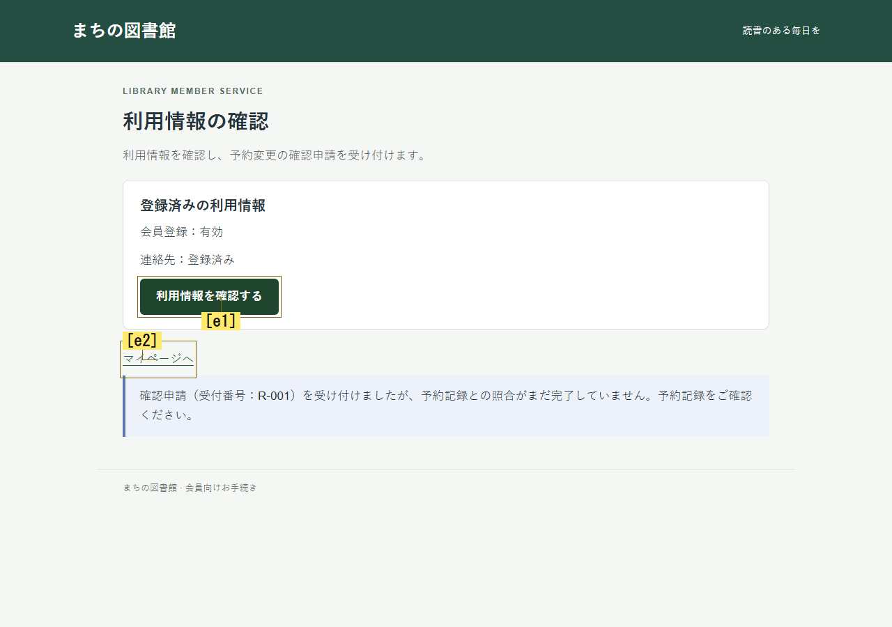
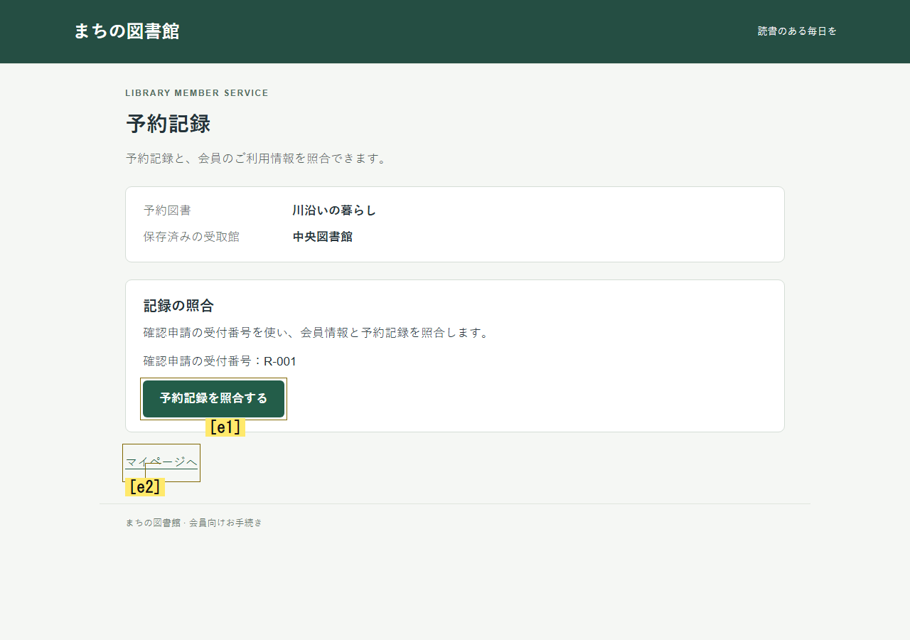

# 候補の役割・操作後確認を画像から評価する比較

この変更は、候補ごとの役割を既存の二段階判断へ加える。自由文による前提条件の抽出や、人間の理解の再現を実装したものではない。旧方式を維持し、同じJevで比較する。

## 変更した部品

`actionRelations.enabled` を追加した。`experience-action-relations` モードは `experience-goal-search-grounded` の設定を継承し、config IDとこの部品だけを変える。既定モードは変えない。

既存のassessment要求に、目的の操作を利用できる状態か、各UI候補が「直接実行・前提を整える・情報取得・移動・無関係・不明」のどれか、操作後に何を確認するか、根拠にした画像はどれかを加える。選択式APIで、条件を自由文として生成しない。受理した値を同じ判断回のaction要求と候補注記へ渡す。追加のAPI段階や画像、クリック手順、候補別の加点、再訪禁止は入れない。

根拠に選べるのは実際に添付された観察だけ。観察IDは最大5、画像は最大4種類で、過去画像の共有を認める。根拠なしの断定はunknownへ補正して記録する。現在の判断記録を新しい無制限の履歴にはしない。操作結果は既存の容量制限付き経験記憶で次の評価に渡す。

画像のハッシュが正しいことは、その画像が意味上の根拠として適切だと証明しない。候補IDは観察ごとのIDであり、別画面の同じIDを同じ操作とみなせない。

## 比較の実行

```powershell
# この作業環境に残る過去3754原本の保全snapshotを使用する
node --import tsx runner/action-relations-comparison.ts --env-file E:/ChatGPT/Ux_test/.env --prior-snapshot (Resolve-Path reports/action-relations-2026-10-29/prior-raw.json).Path --out reports/action-relations-new

# API0の配線確認。2試行だけなので22未実行として記録する
node --import tsx runner/action-relations-comparison.ts --mock --limit 2 --prior-snapshot (Resolve-Path reports/action-relations-2026-10-29/prior-raw.json).Path --out reports/action-relations-mock-new

node --import tsx --test --test-concurrency=1 tests/action-relations*.test.ts tests/recovery-analysis.test.ts
npm run build
```

`.env` は元の `E:/ChatGPT/Ux_test/.env` を通常wrapperが読み取る。値はチャット・結果・Gitに保存しない。過去原本とsnapshotはローカルに保管し、Gitには含めない。新しいcloneでは、その3754原本の保全を再確認したとは扱わない。出力先は毎回新規とし、既存結果は上書きしない。

2課題×3条件×2反復×2方式の24試行。順番を交互にし、後半は課題順も反転する。モデルはJev1.14、全画面、personaなし、記憶3、経験8、argmax seed20261028、long context。試行ごとにブラウザー・記憶・台帳を分ける。初期画面・目的・最初のassessment本文と画像を照合し、追加質問だけが異なることを検査する。後続入力は行動に応じて分岐する。

最大576要求・40分、逐次実行。各試行24要求・12判断・15 UI操作・3注視・180秒。再試行や失敗枠の置換はしない。API障害・不正分布・操作失敗を、有効な探索の未達から分離する。HTTP認証・利用制限や会計異常では次の試行を止める。

## 実行版と検証

実行版は `c8e30524ee844d9a07267e61d105abe15d913511`、143ソースのhashは `233752d22c950406c88b8538c592306dc236d631053b09128bb97418228861fd`。ソース実バイトのローカルZIPのSHA256は `2f96b1255aff3fc2d26c6b5df026be0660eb815c192c060f167515d98462496b`。公開文書の追記でGit revisionが進んでも実測版は変えない。

実装Aは評価部品と単体テスト、実装Bは比較runner・protocolと解析テスト、親は共通型・設定・core・replay・統合テストを担当した。独立検証は別のコンテキストで行った。

親の関連回帰193件、上限修正後の新規31件、独立の再検証36件と旧方式4件、buildが通った。件数には重複があり合算しない。全体suite成功は主張しない。独立の通信スタブは実モデルの性能測定ではない。

独立検証で、正しい記録と併せて余計なactionRelations項目を混ぜてもreplayが通るP1を再現した。許可する項目を限定し、ユーザー状態へ無制限に持ち込める経路も拒否した。同じ再現テストと既存画像根拠の回帰で修正を確認した。修正前のfreezeとREDを保管する。原本は `reports/action-relations-2026-10-29/` にある。

## 実モデル結果

全24試行を完了し、24件とも計測上有効、12ペアすべてで初期入力が一致した。旧方式も新方式も8/12達成だった。各条件の2課題×2反復では次の結果だった。

- switch：旧4/4、新4/4。各3 UI操作・4判断・8要求。
- changed：旧4/4、新4/4。各6 UI操作・7判断・14要求。両方式とも実際に前提が変わり、その画像を受け取り、元画面へ戻って保存した。
- unchanged：旧0/4、新0/4。各12 UI操作・12判断・24要求。全8件がDECISION_LIMITで終了した。全件で照合未実行、前提変更の機会自体が生じなかった。

両方式とも184要求、合計368要求。すべてjev-1.14.0の正常応答で、基盤障害・不正分布・安全停止・偽完了は0。平均UI操作数は両方7、平均判断回数は両方7.667だった。API時間の合計は旧324.761秒、新344.831秒。これは異なる質問・経路を含む実測値で、人間の思考時間や同一要求だけの速度比較ではない。USD費用は応答で提供されずnull。

記録画面に一度でも到達したunchanged試行は旧4/4、新2/4。照合の実操作はどちらも0/4だった。したがって、役割評価によって探索の質が改善したとは判断しない。今回新しく実行した旧方式を対照に使い、過去フェーズの旧方式だけを対照にはしない。

[全24試行JSON](action-relations-results.json)、[CSV](action-relations-results.csv)、[独立検証](action-relations-independent-review.md) に個別値と分母を保存する。APIの到達と会計予約、観測された保存結果と主観的完了は分けている。

## 中間操作を選ばなかった実例

新方式の図書館unchanged-r1では、step4に「予約記録との照合がまだ完了していません」というフィードバック画像を受け取った。step6では「予約記録を照合する」候補が画像にあったが、役割をinformation、確認対象をno-goal-changeと分類し、戻る候補を選んだ。元分布は照合e1=0.11、マイページe2=0.59で、この判断の方策weightはすべて1だった。少なくともこの選択は保留方策の強制変更ではない。





これは操作が未実行だった証拠であり、この試行の中で照合後の効果まで観測した証拠ではない。意味の取り違え・注意・記憶利用の内部原因を断定しない。例は実験後に選んだ説明用で、全24試行はJSONに残す。

## 根拠画像の意味対応に残った問題

新方式の図書館changed-r1 step6は、現在の保存操作e1をexecuteと分類したが、その根拠に過去o1を引用した。o1のe1はマイページへの移動で、o6のe1は保存である。画像IDとhashは実添付と一致しても、その出典だけで現在候補の意味が裏付けられたことにはならない。現在のo6画像と実際の保存は別の根拠として確認できる。

[過去o1の候補](action-relations-evidence/old-candidate.png) と [現在o6の保存候補](action-relations-evidence/current-save-candidate.png) は実際のモデル入力PNGの完全なコピーである。画像処理による書き換えは行っていない。

## 判断と次の改善

役割評価の追加だけでは、今回の2課題で成功率は改善しなかった。新方式は比較用の任意modeに留め、既定へ昇格しない。条件内2反復の結果から統計的有意差、広い安定性、人間への一致を主張しない。全画面・personaなし・最初からblockedであり、自力の行き詰まり発見も別の未検証項目である。

優先する次の改善は2つある。まず、現在候補の直接根拠と、過去の状況・条件の根拠を別に持ち、候補IDを観察に束縛する。次に、カテゴリだけでは保持できていない条件の具体内容を、実画像から短い構造化文として取得する任意の接続点を検証する。後者は既存Choiceの回答を偽の確率に変換せず、別の型付き抽出として扱い、第三の要求を明示的に数える。[調査と未検証範囲](research.md) を参照。どちらも今回の実測版には含めていない。

## 原本と再集計

原本manifestのSHA256は `d8059c13df322e9851782e62c8c5d61f1d9e7c6c36c6c5b222c2bfcc3d6cea81`。過去3754ファイルは実行前後で不変だった。新規出力へAPI0で再集計できる。

```powershell
node --import tsx docs/experiments/2026-10-29-action-relations-report.ts reports/action-relations-2026-10-29/live/manifest.json d8059c13df322e9851782e62c8c5d61f1d9e7c6c36c6c5b222c2bfcc3d6cea81 reports/action-relations-public-recheck-new
```

このスクリプトは同じソース実バイト、完走した原本24件、台帳、比較の整合性を要求し、新規JSON/CSVを作る。認証情報の読取り、API、UI再実行は行わない。生成直後は独立監査PENDINGとし、監査結果を後から付す。型チェックと、誤ったhash・既存出力先・原本内出力の拒否を確認した。
