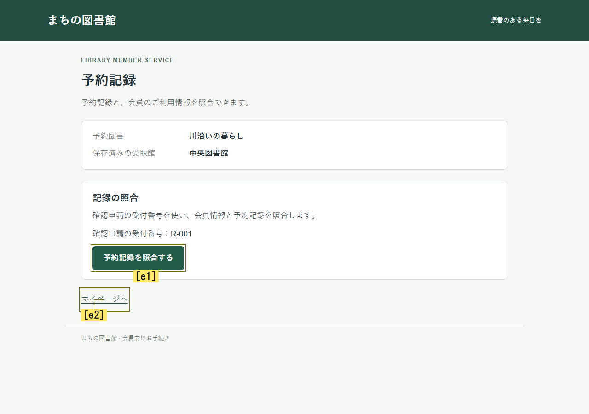

# 確認意図と結果の質問を揃える

2026-11-05。新旧各4枠、計8枠を予定し、実行8・有効8・無効0・未実行0。旧質問方式は3/4達成、新質問方式は1/4達成、264要求だった。目的達成率だけでは探索の自然さを判断しない。新方式は任意設定のまま、採否は動作評価待ちとする。

評価訂正：達成率を採否の主根拠にした判断は撤回する。未達でも自然な探索はあり、成功だけで自然さは認定できない。[動きの再レビュー](inquiry-movement-review.md)でモデル由来と補正由来を区別した。

前回の問題は、条件・意図・checkを独立に答える形式と、受理時に許す組合せが一致していないことだった。[前回](inquiry-outcome.md)のJev32判定中27件がunknownで、11件は直前checkがunknownだった。OpenAIでは経路確認への条件状態回答も発生した。これは質問と検査の不整合であり、全てのunknownが誤りという意味ではない。前回はchangedも含むため、今回の分母と混ぜない。

## 変更と境界

比較の基準は3a3dcc7。実行生成版は03218d6844050a8456fe270f86741afe7f7242bc、実行ソースは252b4174856c4fd9b30ac98a89f47f39b860879e24155c6f87666d03080cee93（165ファイル）。
実装を17ファイルへ統合した。元のE:/ChatGPT/Ux_testの未コミット変更は保持した。

- 実装担当：working-inquiry.ts、inquiry-outcome.tsと質問テスト。
- 親：共通型・設定、core、replay、profiles、mock、比較runner、統合・回帰テストと実行。
- 別コンテキストの検証担当：固定版のテスト、正常replay、故障注入、実ログ監査と公開資料の照合。

新モードexperience-inquiry-alignedはexperience-inquiry-outcomeを継承し、visualHypotheses.inquiryQuestionPolicy=aligned-v1だけを追加する。既定モードは変えない。

1. workingInquiry_planは、既存の条件と整合したintent/checkの組からモデルが1つ選ぶ。コードは型として有効な組を列挙するだけで、UIの正解操作は登録しない。原本のchoiceと全確率はassessment.responseに残る。既存rawChoicesフィールドはこのモードでは選ばれた組を復号した値であり、独立3回答ではない。
2. 次の結果質問は、前に選んだcheckと互換なカテゴリだけを提示する。条件状態ならcondition_*、経路ならroute_*、check自体が不明ならunknownだけになる。
3. 現在画像が未達や限定的な判断の根拠になることも説明する。current_imageは成功を意味しない。根拠なしの主張をunknownへ下げる検査は維持する。

モデルは提示された条件、計画、実操作結果を使う。監査DOM、客観的成功、全履歴、人間の記録を追加送信しない。候補・共有重み・seed・sampler・画像認識・API段階・容量3は変えていない。
供給される複合条件は今回も分解していない。ネイティブ抽出への原子条件生成の実装や、人間の認識の再現を完了したとは扱わない。

## 固定した比較

[事前計画](../superpowers/plans/2026-11-05-inquiry-alignment.md)と[比較設定](../../experiments/virtual-beta/inquiry-alignment-comparison.json)を固定した。

図書館／講座予約のunchanged条件 × 旧／新 × 各2反復で8枠。新旧の先行順を各課題・反復で入れ替えた。personaはnull、behaviorはgoal。
各試行12判断・15UI操作・3注視・300秒・画像抽出60秒・最大36要求。全体288要求・42分・並列1・再試行0。失敗枠を差し替えない。

- library・r1・experience-inquiry-aligned：36要求、12判断、客観達成false、DECISION_LIMIT、有効=true。
- library・r1・experience-inquiry-outcome：30要求、10判断、客観達成true、SUBJECTIVE_DONE、有効=true。
- workshop・r1・experience-inquiry-outcome：30要求、10判断、客観達成true、SUBJECTIVE_DONE、有効=true。
- workshop・r1・experience-inquiry-aligned：36要求、12判断、客観達成false、DECISION_LIMIT、有効=true。
- library・r2・experience-inquiry-outcome：30要求、10判断、客観達成true、SUBJECTIVE_DONE、有効=true。
- library・r2・experience-inquiry-aligned：30要求、10判断、客観達成true、SUBJECTIVE_DONE、有効=true。
- workshop・r2・experience-inquiry-aligned：36要求、12判断、客観達成false、DECISION_LIMIT、有効=true。
- workshop・r2・experience-inquiry-outcome：36要求、12判断、客観達成false、DECISION_LIMIT、有効=true。

- experience-inquiry-outcome：raw unknown 0/38、受理後unknown 31/38、内訳 {"unknown":31,"condition_satisfied":5,"condition_unmet":2}。working check unknown 13/42、working補正16件、結果補正 {"RESULT_CHECK_MISMATCH":11,"NO_CURRENT_IMAGE_BASIS":30}。共有方針による選択変更2回。
- experience-inquiry-aligned：raw unknown 2/42、受理後unknown 9/42、内訳 {"condition_uncertain":21,"unknown":9,"condition_unmet":8,"route_found":1,"condition_satisfied":3}。working check unknown 0/46、working補正0件、結果補正 {"NO_CURRENT_IMAGE_BASIS":7}。共有方針による選択変更5回。

補正理由は重複を含む。判定件数は構造的に受理できた観測結果、成功率は有効試行を分母とする。不正・欠測を通常のunknownへ数え替えない。

不整合カテゴリが出なくなることは選択肢の制約による構造的な性質であり、意味理解や探索能力の改善を実証しない。
unknownがcondition_uncertain/current_imageへ変わっただけなら、新しい知識が増えたとは限らない。current_imageはモデルの申告で、正しい読み取りを保証しない。モデル分布は人間の行動頻度ではない。

実画面との意味の一致は独立監査の事例確認と未検証範囲を分けた。

図書館の新方式r1・step6では「受取館が中央図書館から東分館へ変更され、保存されたことを確認できる。」をcondition_unmet/current_imageと判定した。実入力の保存値は中央図書館だった。「予約記録を照合する」e1が見えていたが、e2「マイページへ」を選んだ。e1は抽出段階でrelation=information、conditionIds=[]、expectedResult=null、行動評価ではeffect=unknownだった。この例は結果の型を揃えるだけで操作選択が改善することを示していない。原因をこの分類だけに確定もしない。

画像は失敗箇所の説明として事後選択した。今回の実入力と同じSHAの既存PNGを流用しており、評価指標として選定していない。

新方式の図書館r2・step7では「申請後の予約記録との照合が完了している。」をcondition_satisfied/current_image、全体Goalをunsatisfiedと分けて判定した。実入力には照合完了が表示され、保存先はまだ中央図書館だった。その後、この試行は目的達成した。部分条件の評価が画面と一致した一例であり、全体の成功率や再現性の改善を示さない。

既存の共有選択方針によるモデルchoiceと実選択の違いも記録した。新部品による重み変更とは扱わない。
初期画面・目的・画像抽出要求は照合するが、モデル出力と後続履歴は別々に生成される。2反復の記述的比較から広い安定性や人間一致を認定しない。
API待機時間はユーザーの思考時間ではなく、DECISION_LIMITは人間の離脱ではない。

## テストと独立検証

親の関連85テストは最終runner修正前、修正後の関連21テストも通過。集合が重複するため合算しない。型検査・Viteビルドも通過した。全suite完走の主張はしない。
独立1回目は関連28テストが通った一方、故障注入で以下の3件を発見した。

- F1：不正なモデル出力で後続試行が続く。INVALID_DISTRIBUTIONをMODEL_OUTPUT_FAILUREで停止するよう修正。
- F2：初期入力の不一致でも比較が続く。不一致ペアを両方invalidにして停止し、未実行6枠を残すよう修正。
- F3：固定ソースの変更で止まってもRUNNINGが残る。終端エラー・preservationAfter=falseを保存し、CLIをexit1にするよう修正。

修正後は独立15テスト、同じ3故障、CLI終了コード、台帳作成例外でのFAILED保存を再確認した。通常mockは8有効・4初期ペア一致・要求0、独立replayも通った。mockの目的達成は実モデルの成功に含めない。
最初のFAIL・固定ソースZIP・改変記録は保持した。

別途の追加故障検査でP2を確認し、実モデル実験の完走後に修正した。結果生成前のMISSING_CREDENTIALSを、使用数0でも会計異常へ上書きしていた。結果がある場合だけapiCallsを比較し、結果なし・使用0なら元エラーを保持するよう最小修正した。結果なし・使用あり／予約ありでは保守的な会計異常とし元causeも保存する。

追加再検証で、集約後のMath.max値による台帳不足の見逃しも発見した。生のledger.usedで照合してから集約し、過少・過大の両方向を検査するよう修正した。R3のFAILを保持し、最終R4で再検証した。生成済み実8件は生の台帳used・API回数・receiptが一致しており、この漏れは実データでは未発現だった。

最終版はab967d46e6f88062f5b05bfbdf0a9d43879a9173（source a4a62728cc89d38ddddf6632cacc5047d175756899355aa390f858085133f55a）。実モデル8試行の生成版とは分ける。実モデルの質問・画像・操作処理は変更しておらず、最終版では親の関連8テスト、型検査・ビルド、独立17テスト、6故障条件、正常mock8件と独立replay8件を確認した。

- [独立1回目：FAIL](inquiry-alignment-review-round1.json)
- [修正後：PASS](inquiry-alignment-review-round2.json)
- [実ログ監査](inquiry-alignment-review-live.json)
- [結果生成前エラーの追加再現](inquiry-alignment-review-extra.json)
- [会計追加修正の再検証：FAIL保持](inquiry-alignment-review-round3.json)
- [3回目の修正と再検証](inquiry-alignment-review-round4.json)

実ログ監査のPASSは、配信・source・分布・選択・会計・再生・集計の整合性の範囲である。意味理解や有効性の認定ではない。過去6947件は親が実体SHAを検査し、独立側はmanifest情報を照合した。新規架空UI原本の独立検査と区別する。

## 実行方法

リポジトリルートのPowerShellで、新しい出力先を指定する。

    npm run build
    node --import tsx --test --test-concurrency=1 tests/inquiry-aligned-questions.test.ts tests/inquiry-aligned-runtime.test.ts tests/inquiry-aligned-integration.test.ts tests/inquiry-aligned-comparison.test.ts
    $stamp = Get-Date -Format yyyyMMdd-HHmmss
    $prior = (Resolve-Path experiments/virtual-beta/empty-prior-snapshot.json).Path
    node --import tsx runner/inquiry-alignment-comparison.ts --mock --prior-snapshot $prior --out "reports/alignment-mock-$stamp"

実モデル：

    $stamp = Get-Date -Format yyyyMMdd-HHmmss
    node --import tsx runner/inquiry-alignment-comparison.ts --prior-snapshot $prior --env-file E:/ChatGPT/Ux_test/.env --out "reports/alignment-live-$stamp"

empty snapshotは過去原本のないcheckout用。この作業環境で再実験するときは、$priorをreports/inquiry-alignment-2026-11-05/final-prior-raw.jsonの絶対パスへ変える。
新規の通常runner要求だけを使用し、保存入力を直接再送しない。資格情報はログ・コミットへ含めない。

## 残る課題と成果物

1. 複合条件の粒度と候補の予測結果を別々に検証する。今回、既存の複合条件は変更していない。
2. 候補の効果予測と実際の操作選択を切り分ける。モデルchoiceと共有方針による実選択の違いも残す。
3. unknown件数だけでなく、現在引用の正確性と新たに分かった情報を検証する。
4. 別課題・ペルソナ・人間比較には追加データが必要であり、人間一致は未検証とする。

原本・入力画像・台帳・要求／回答・固定ソース・検証コードはreports/inquiry-alignment-2026-11-05/。Git管理外の原本と、公開する[比較JSON](inquiry-alignment-results.json)・独立監査原文を分ける。
実モデル実行の新規原本347件、保護済み過去分と合わせて7294件。実行ソースZIPはsource-252b4174.zip、SHA 5d81049ea0b7333f1204d69b350ba40b47d0291ca2f620675ba4dc27a4b0f5ce。Gitはworking-inquiry-contracts.tsと質問テストの改行をLFへ正規化しているため、実行バイト列のhash検査には保存したZIPを使う。

新規の論文コード・学習依存・モデル・重みを採用していない。追加調査は、複合条件の粒度、条件と中間操作の対応、現在引用の正確性を優先する。人間の操作との一致には別の比較データが必要である。
