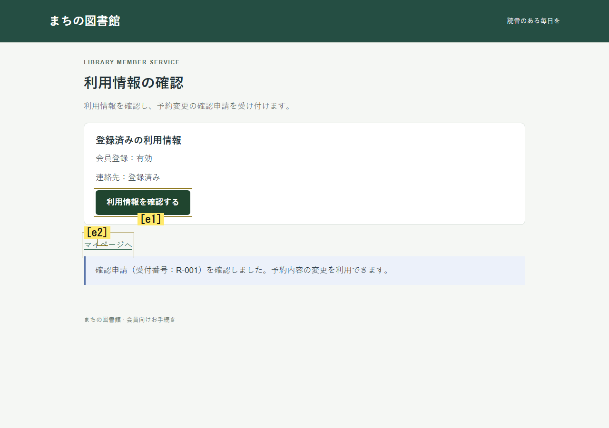

# JevとOpenAI Decisionsの同条件比較

同じ架空ローカル画面・目的・記憶・質問・行動方策を使い、判断APIだけをJev1.14とOpenAI Decisions（gpt-6-luna）で切り替える。今回、候補の役割判定や前提条件の表現は追加していない。両モデルの比較と判断設計の変更を同時に行わない。

## 接続と実行

既存の画像、候補、状態、二段階判断、PhaseBudget、Playwright実操作、oracle、replayを流用する。追加のSDK・依存はない。OpenAIの[公式Decisions仕様](https://developers.openai.com/api/docs/guides/decisions)に従い、同じ入力JSONと画像IDを付けた全画像、同じ質問・選択肢を変換して送る。確率配列は既存のChoiceAnswersへ変換し、既存samplerが実選択に使う。入力表現はAPIごとに異なるため、文字通り同じHTTP本文の比較ではない。

認証はローカルの外部.envに AI_GATEWAY_API_KEY と OPENAI_API_KEY を設定する。既存キーを消さず、値はチャット・結果・Gitへ含めない。比較APIを選ぶオプションは明示的で、従来runnerの既定はJevのまま。

```powershell
# 単独の通常wrapper。承認済み24要求の新規PhaseBudgetを別途用意する
node --import tsx runner/human-jev-experiment.ts --mode experience-goal-search-grounded --backend openai-decisions --phase-budget reports/new-budget.json --env-file E:/ChatGPT/Ux_test/.env --out reports/openai-new

# 今回の原本を保管している環境での新規並列比較
node --import tsx runner/provider-comparison.ts --env-file E:/ChatGPT/Ux_test/.env --prior-snapshot (Resolve-Path reports/provider-comparison-2026-10-29/prior-raw.json).Path --out reports/provider-new

# API0の配線確認。実モデル性能ではない
node --import tsx runner/provider-comparison.ts --mock --limit 1 --prior-snapshot (Resolve-Path reports/provider-comparison-2026-10-29/prior-raw.json).Path --out reports/provider-mock-new

node --import tsx --test --test-concurrency=1 tests/provider-*.test.ts tests/openai-decisions-evaluator.test.ts
npm run build
```

prior snapshotは過去2851原本のパスとhashを保持するローカルファイルであり、生の原本と共にGitへ含めない。履歴のないcloneでは同じ原本保全を確認できたとはしない。既存出力先への上書きは拒否する。

## 固定条件と保存

2課題×3条件×2反復×2providerの24枠。各ペアの2providerを並列実行し、両方が終わってから次へ進む。全体上限576要求・40分、並列2。各試行24要求、12判断、15 UI操作、3注視、180秒。新しい正解手順は渡さず、未達枠を成功試行で置き換えない。保存済み入力のAPIへの直接再送はしない。

actorはexperience-goal-search-grounded、全画面、personaなし、状態記憶3、経験8、argmax seed20261028。各試行は独立したブラウザー・状態・台帳を持つ。初期の製品画像と最初のassessmentのJSON・画像・質問を比較する。最初のactionもassessment結果によって変わるため、後続経路の一致は要求しない。

manifestにproducer/source、protocol/profile/charter、全24予定枠、実行UUID、各結果・台帳・画像照合を保存する。summaryはproviderごとに既存recovery解析を流用し、予定・試行・有効・未実行、成功、主観完了、判断上限、API障害を分離する。HTTP401/402/403/404/429や台帳障害では次ペアを開始しない。同時進行中の相手は上限内で終わり、その要求も数える。HTTP再試行は0。

実際の返却model名と使用token、API時間を記録する。費用はproviderが報告した部分だけを既知として集計し、不明なUSD費用を0としない。API時間は利用者の読解・迷いの時間ではない。確率・confidenceを人間の行動頻度として扱わない。

## 結果

固定producerで全24試行を実行し、全件が計測上有効だった。Jevは8/12達成、OpenAI Decisionsは4/12達成。API障害、不正分布、安全停止、誤った主観完了は両方とも0。未達12件はすべて12判断のDECISION_LIMITだった。


## 実行前の検証と計測修正

親の関連回帰67件、並列HTTPスタブ統合2件、型チェック・buildを実行した。独立検証では、APIの分布をsamplerへ渡すこと、画像と質問の保持、既定Jevのdispatchと従来初期入力の回帰、認証エラー・台帳保存障害時に次ペアへ進まないことを検証する。モックと通信スタブは実モデルの性能測定ではない。

独立検証でP2として、台帳への予約をAPI到達と誤集計し得ることを再現した。要求予約は消費数として維持し、HTTP試行の明示証拠、応答またはHTTP状態による到達証拠、証拠不足のunknownを分離した。timeoutだけではAPI受領と断定しない。修正前のRED、修正後のGREEN、元のfreeze、変更した2ファイルのhashをローカルの independent-preflight に保存する。

対象を固定した監査テストはreports内に保存し、通常testsには再利用できる4回帰を残す。書式診断は固定版の3ファイルで末尾空行を報告しており、空白診断の成功は主張しない。全体suiteは別担当が途中実行後に中断しており、既存のEPERM・ブラウザー失敗があった。今回の関連検証の成功を全体suite成功へ置き換えない。


## 実モデルの比較結果

全12ペアで初期製品画像、最初のassessmentの入力JSON・画像・質問が一致した。各セルの2反復でも初期画像とconfigは一致した。source・UI・actor・profile・protocol・charterは実行中に変更していない。結果を見た後のactor調整や失敗枠の置換も行わなかった。

- switch（別の入口へ切替）：Jev4/4、OpenAI4/4。両モデルとも各3 UI操作・4判断・8要求で保存できた。
- changed（確認で前提が整う）：Jev4/4、OpenAI0/4。Jevは各6 UI操作・7判断・14要求で保存。OpenAIは各12判断・24要求で未達だった。
- unchanged（確認だけでは前提が整わない）：両モデル0/4。いずれも12判断・24要求で未達だった。

全24試行で408要求を消費し、408 OK、ERROR0、RESERVED0。内訳はJev184、OpenAI224。実返却名はそれぞれjev-1.14.0が184応答、gpt-6-lunaが224応答だった。試行前予約、実HTTP試行の明示証拠、応答の証拠が今回はすべて一致し、到達不明の試行は0。

[全結果JSON](provider-comparison-results.json)、[24行CSV](provider-comparison-results.csv)、[独立検証](provider-comparison-independent-review.md) に分母と個別値を保存した。最初のassessment以降はモデルの回答で記憶・質問・操作が分かれるため、後続の全要求が同じ入力とは主張しない。

## 実際に分かれた行動

changedの4件では、両モデルとも最終的に確認を実行し、前提が整った状態の画像も受け取った。Jevは4件とも元画面へ戻って保存した。OpenAIは4件とも変更後の元画面へ戻らず、確認画面に残った。確認回数は各3回で、全4件に注視1回があった。

例として図書館changed-r1のOpenAIは、step2/4/6にホームからまだ変更できない画面へ入り、step9で利用情報を確認した。step10の画像には「予約内容の変更を利用できます」と表示されていたが、step10/11も利用情報の確認を選び、step12は注視を選んで上限終了した。step10の確認候補の元確率は0.45、選択と実操作も確認だった。実験後に選んだ例示で、全24件はJSONに残した。



この画像はモデルへ送ったPNGの完全なコピーで、加工していない。表示・送信された事実と、モデルが表示の意味を理解したかは区別する。同じ画像が別の試行にあっても、履歴や質問まで同じとは限らない。

unchangedでは両モデルの全8件が記録照合を実行せず、前提変更の機会そのものに到達しなかった。「変更後に戻ることを8件失敗した」とは数えない。前提未変更の元画面への再訪はJev4試行8回、OpenAI2試行2回だった。OpenAIの再訪回数が少ないことだけで探索改善とは判断しない。

選択方策による元分布からの変更はJev5回、OpenAI0回。OpenAIの今回の未達を一時保留による強制選択では説明できない。一方、方策を無効にした対照は実施していないので、Jevの全失敗も含め方策の因果効果は結論しない。

## 時間・費用と判断

記録されたAPI時間の合計はJev341.248秒、OpenAI126.469秒。要求数で割ると約1.855秒/要求と0.565秒/要求だった。実際の経路・質問構成・画像数が分岐した後の記述値であり、同一要求だけの速度benchmarkや人間の操作時間ではない。

token報告はJev入力25,044,502・出力103,265、OpenAI入力2,629,022・出力0。APIごとのtoken計数と画像処理が異なるので、この比から費用差を算出しない。両方の応答にUSD費用は提供されず、costUSDはnull。knownCostUSD=0は既知の費用の合計が0という実装上の値で、無料だった意味ではない。

今回の固定した設計と12件ずつの範囲では、OpenAIへの差し替えで目的達成は改善しなかった。既定backendはJevを維持し、OpenAIは明示オプションとして残す。OpenAI全般の能力や他モデルへの一般的優劣は結論しない。

次の実装候補は、画面から見える未解決の前提と、それを変える候補を選択式で関係付け、操作結果で再評価すること。候補ごとの「直接実行／前提を整える／情報取得／移動／無関係／不明」をモデルに問う変更を単独で比較する。特定ラベルの加点や再訪禁止ではなく、無関係な確認操作にも飛び付かないか、成功していた必要再訪を壊さないかを負例で測る。今回この改善はまだ実装していない。

## 固定版とオフライン再集計

producerは0d4b450544d12ac9fafd9ba32c7bb7b25f938d9a、source141ファイルのhashは8cf3d1669b78711b4d8977d1d411e35a9dd2e59229161ca0887fde3be00eae1d。ローカル原本903ファイルは reports/provider-comparison-2026-10-29/live/ に保存する。以前の2851原本は実行前後のhashが一致した。

sourceの実バイトはproducer-source-8cf3d166.zipに保存し、SHA256は79884247cc30bb7230a8dafc0ff9d78c79c3a20a86353be258a74743acaa7c33。認証・環境ファイル、人間の操作記録は含まない。公開文書の追記でGit revisionが進んでも、実測producerは変更しない。

次の[オフライン変換](../experiments/2026-10-29-provider-report.ts)は指定manifestのhashと原本・台帳・現在画像を照合し、新規ディレクトリにJSON/CSVを生成する。API0・UI再実行0である。独立監査前の出力はindependentAudit=PENDINGとする。

```powershell
node --import tsx docs/experiments/2026-10-29-provider-report.ts reports/provider-comparison-2026-10-29/live/manifest.json 72707058bcd9086df6246bf534abdbead674c6fca0986aec131886f37ef54d4b reports/provider-public-recheck-new
```

各条件2反復の記述比較であり、独立な無作為標本や統計的有意差とは扱わない。API表現・画像処理の違いも含む実用上のbackend比較である。今回も開始時からblocked、全画面、personaなしで、自力の行き詰まり発見・対象集団の人間一致は未検証。実装・計測の成立と、探索能力・人間再現の未達を分ける。
