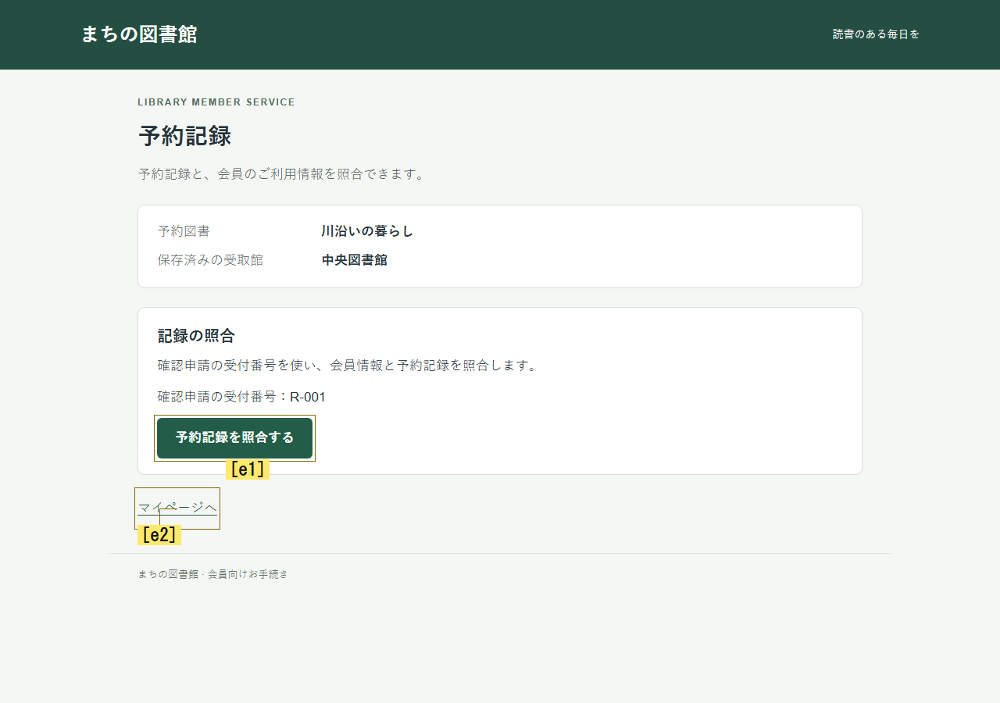
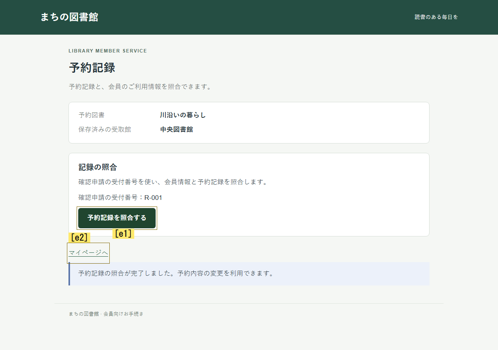

# 過去の未解決条件と現在の操作候補の接続

2026-10-30。実装・統合・独立検証・実モデル実行を完了したが、探索の安定した改善は確認できなかった。
新規Jev比較は4試行124要求で、3試行は判断上限、1試行はモデル出力の不整合により停止した。
全4試行で照合操作は0件、最終保存も0件だった。
追加したOpenAIの機能確認は2試行72要求で、図書館の照合操作が1件実行されたが、両課題とも最終保存は未達だった。
目的達成までの改善は引き続き未完了である。

[結果JSON](visual-prior-links-results.json)に版・各試行・分母・原本のSHA-256を保存した。
今回のOpenAI実行は、新規入力による機能確認であり、以前の24試行によるプロバイダー比較とは別に扱う。

## 基準と変更

実行版は feature/virtual-beta-information-state の f5c1786eb648df3c5e13d7db08fd230b5b5014d5。
実行に関係する158ファイルのhashは9ffb0aa77e39c5d8cb4a14837781459f4802e5e20befecf8eff461e379ae5aa3。
資料公開後のコミットを、この実行の生成版として扱わない。
原本・固定ソースZIP・台帳・実配信入力はローカルの reports/visual-prior-links-2026-10-30/ にある。
reports配下はGit管理外であり、公開資料には結果と独立監査の原文、実入力画像2枚を収録した。

現在画像から抽出した条件だけでは、過去に分かった未解決条件と今のボタンの関係を判断へ渡せない場合があった。
そこで、モデルが現在の操作候補を、判断時点の容量制限付き記憶にある未解決条件IDへ対応付ける任意設定を追加した。
正解経路をコードに登録したり、照合ボタンの確率を増やしたりする変更は加えていない。

- 実装A：visual-prior-relations.ts、visual-action-checks.tsと担当テスト。候補と過去条件の受理・検証・候補別投影を担当した。
- 実装B：visual-hypotheses.ts、openai-visual-hypotheses.tsと担当テスト。画像抽出の任意スキーマと受理境界を担当した。
- 親：型、設定、core、replay、プロファイル、比較runner、タイムアウト、統合テストと実行を担当した。
- 別コンテキストの検証担当：固定ソースで回帰、実操作、改ざん、最終HTTP、実ログ集計を検査した。

主要実装は [接続部品](../../jev/virtual-beta/visual-prior-relations.ts)、[候補別投影](../../jev/virtual-beta/visual-action-checks.ts)、[core](../../runner/virtual-beta-core.ts)、[比較runner](../../runner/condition-continuity-comparison.ts)、[replay](../../runner/virtual-beta-replay.ts)。
依存・学習モデル・重み・UIは追加変更していない。

## 設定と境界

プロファイル experience-visual-conditions-prior-links が新方式。
対照は experience-visual-conditions-checks。
新方式は visualHypotheses.priorConditionLinks=true とし、enabled、candidateChecks、continuity を必須にする。
両条件で grounded-unresolved の容量3、試行300秒、判断12、UI操作15、注視3、36要求、並列1、再試行0をそろえた。
画像抽出の上限は、今回の両条件で明示的に60秒へ設定した。
既存の既定値30秒と180秒試行は維持している。

モデルが出す priorConditionIds は、入力された過去記憶のうち根拠付き未解決条件だけを参照できる。
重複・未知ID・別目的・別出典・不正候補・根拠のない対応は拒否する。
受理した対応は visualPriorRelations として保存し、評価段階と行動選択段階の両方、候補別の recalledConditions に渡す。
過去の引用は historical、状態は last-assessed と明示し、現在画像で確認できた事実へ昇格させない。
確率の補正、過去条件の自動解消、記憶容量外の復活は行わない。

観察は実際の画像と引用、固定特性はpersona、目的と禁止事項はcharter、利用可能な記憶はbounded state、候補対応はモデル仮説として区別する。
全履歴・客観的UI状態・成功判定は監査に保持する。
今回のpersonaはnullであり、ペルソナ効果の新たな検証はしていない。

## 実行結果と停止理由

Jevの実行順は、図書館の新方式、図書館の対照、講座予約の対照、講座予約の新方式。
要求数は順に36、36、36、16。
最初の3試行は判断12回の上限で終了し、最後はモデル出力の不整合で終了した。
照合は全て0件、客観的保存達成も全てfalse。
有効比較ペアは図書館1組であり、講座予約は有効ペアになっていない。

最後の停止は、HTTP通信の失敗や人間の離脱ではない。
2つの過去条件IDを同じ現在条件c2へ対応させ、既存のcontinuityの一対一制約に違反した。
今回追加した過去条件リンク自体の受理は通過していた。
なぜモデルが重複対応を生成したかは未特定であり、検査を緩めて成功扱いにはしていない。

図書館の最初の照合画面では、Jevの新方式でも未解決条件が照合候補へ届いた。
それでも照合候補の生確率は0.20、戻る候補は0.69で、実際に戻った。
この場面の重みは全て1だった。
「記憶を渡していない」だけでは、残る選択の問題を説明できない。

OpenAI Decisionsを使った新規2試行は、それぞれ36要求、判断上限終了だった。
図書館では11判断目に照合候補を0.91で選択し、重みは全て1、実際にUI操作した。
次の画像には照合完了と変更可能の案内が表示され、客観状態もrecordChecksが0から1、eligibleがfalseからtrueへ変わった。
12判断目は戻る操作を選び、保存値は中央図書館のままだった。
講座予約では照合0件、保存値は午前の回のままだった。

以下は図書館で実際にモデルへ渡した入力画像。
照合前後であり、最終保存の達成画像ではない。

両プロバイダーの初期UI・画像・目的は一致するが、画像抽出の応答と、その後の履歴は異なる。
各条件1反復のため、UI変更の効果、プロバイダーの因果的優劣、安定した改善を示す結果ではない。

## 回帰と独立検証

親の関連テスト322件、最終関連209件、修正後replay回帰12件が通過した。
独立担当は関連236件、独自の実操作、最終AbortSignalの30秒・60秒・外側期限による切り詰め、17件の再hash付き改ざん検査を通過した。
これらのテスト集合は重複しており、合算しない。
npm run build の型検査とViteビルドも成功した。

独立1回目は、保存された行動質問のnextAction.typeを改ざんしてもreplayが拒否しないP2を発見した。
不正型・欠落・余分なフィールドを拒否する修正と失敗再現テストを追加した。
同じ受入条件で2回目に再検証し、17件全ての改ざんを拒否した。
実配信処理・確率・実操作はこの修正で変更していない。

- [独立1回目：FAILを保持](visual-prior-links-review-round1.json)
- [修正後の独立2回目：PASS](visual-prior-links-review-round2.json)
- [Jev原本の独立監査：PASS](visual-prior-links-review-live.json)
- [OpenAI原本の独立監査：PASS](visual-prior-links-review-openai.json)

最後の2つのPASSは、リプレイ・会計・出典・停止理由・集計の整合性を示す。
行動改善や目的達成の合格を意味しない。
最終監査時に、以前を含む原本6270件と保護対象911件の不変を確認した。

## 再実行と出力

リポジトリのルートからPowerShellで実行する。
資格情報は既存の外部.envを指定し、値を出力やGitへ含めない。

    npm run build
    node --import tsx --test --test-concurrency=1 tests/visual-prior-relations.test.ts tests/visual-prior-hypotheses.test.ts tests/visual-prior-integration.test.ts tests/visual-prior-runtime.test.ts tests/visual-prior-native-timeout.test.ts

公開コマンドもモックで4枠を実行し、予定4・実行4・有効4・無効0・要求0、両課題の初期条件一致を確認した。
このモックは完了を返す固定応答であり、客観的目的達成は全てfalseのまま記録された。
モックによる比較配線の確認はAPIを使わない。
必ず新しい出力先を使い、raw保存済み入力を再送しない。

    $stamp = Get-Date -Format yyyyMMdd-HHmmss
    $prior = (Resolve-Path experiments/virtual-beta/empty-prior-snapshot.json).Path
    node --import tsx runner/condition-continuity-comparison.ts --prior-links --trial-ms 300000 --visual-request-ms 60000 --mock --prior-snapshot $prior --out "reports/prior-links-mock-$stamp"

新しい実モデル比較は次で行う。
既存結果の上書きや欠けた条件だけの差し替えを避け、4枠を新しい実行として扱う。

    $stamp = Get-Date -Format yyyyMMdd-HHmmss
    node --import tsx runner/condition-continuity-comparison.ts --prior-links --trial-ms 300000 --visual-request-ms 60000 --max-requests 144 --prior-snapshot $prior --env-file E:/ChatGPT/Ux_test/.env --out "reports/prior-links-live-$stamp"

empty-prior-snapshot.json は、過去の実行原本がない新規checkout用の空リストであり、以前の実験の保全を証明しない。
この作業環境では $prior を reports/visual-prior-links-2026-10-30/final-prior-raw.json の絶対パスへ変更し、既存6270件の保全を検査する。
今回の実モデル実験では空リストを使っておらず、各実行前後の既存原本を検査した。
OpenAI2試行の実行専用スクリプトは reports/visual-prior-links-2026-10-30/parent/openai-sanity.ts に保存した。
これは実行済み出力先を固定した原本であり、そのまま再実行しない。
通常runnerの decisionBackend=openai-decisions で新しい出力先と台帳を指定できる。

各試行の exploration/result.json と入力画像、段階別の実配信データ、分布、補正・選択、実操作、終了理由、台帳を保存する。
比較全体の manifest.json は設定・版・実行ID・初期画像・要求数・未実行枠を、summary.json は有効/無効/未実行と結果を分ける。
API待機時間を人間の行動時間と解釈しない。

    node --import tsx runner/virtual-beta-replay.ts reports/visual-prior-links-2026-10-30/openai-sanity/recovery-library-unchanged-r1/exploration --require-final-http

## 以前の停止を今回の結果と混ぜない

候補別条件を加えた最初の180秒試行は、予定4枠中2枠・50要求で停止し、有効試行0だった。
続く300秒・画像抽出30秒の試行は4枠・75要求、有効1・無効3だった。
残り時間不足による切り詰めと、上限30秒そのものへの到達を分けて監査した。
後者の生成版は00157b3/source e069、前者はf54/source 69caである。
計画文の生成版ラベルの誤記は公開時に訂正し、固定したproducer-plan原本は保持した。
今回のJev124要求、OpenAI72要求も別の分母とし、合計321要求を性能比較の単一分母にしない。
以前の24試行・408要求による比較や、過去の予算・中断記録は変更していない。

## 次に改善するもの

1. 現在分かる未解決条件と、試した操作・得られた結果を組として評価する。
   対応を渡した後にも戻る・再確認が続いた事実を出発点にし、有用か不明な探索と、結果を変えない反復を区別する。
   正解ボタンの優遇や再訪の一律禁止は入れない。
2. 条件の同一性と現在の根拠を分ける契約を検討する。
   今回の重複対応を再現ケースにし、過去条件を現在事実へ昇格させずに同一性を保持できるか確認する。
   現在の不正出力の受理を緩める変更は未実装。
3. 反復と別課題で検証する。
   目的達成までの上限を事前固定し、中間操作だけの成功、モデル出力失敗、API障害、最終未達を分けて評価する。
4. 対象ユーザー集団との比較データを取得する。
   今回は人間への一致、視覚・記憶・主観的確信の再現を測っていない。
