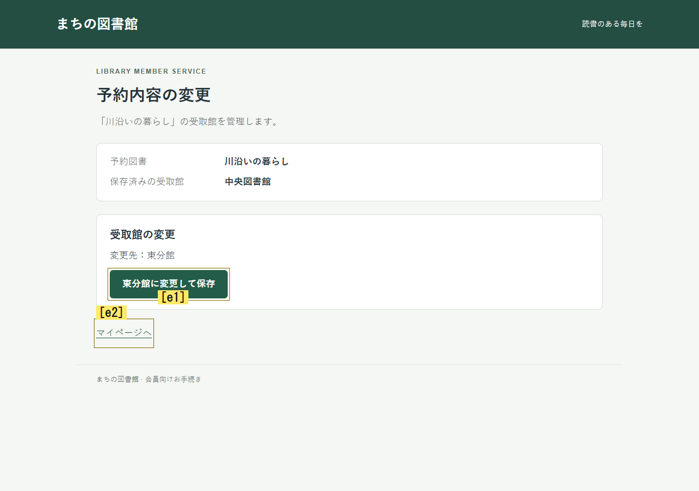

# 今取り組む条件と、操作後に確かめる結果

2026-10-30。未解決条件を渡すだけで中間操作が選ばれない問題に対し、既存の評価段階で「今取り組む条件・意図・確かめる結果」を選ぶ任意部品を実装した。
実Jevの新旧4試行は新方式1/2、対照0/2。新方式の図書館では照合から保存まで達成したが、講座予約は未達だった。
各条件1反復であり、安定した改善はまだ確認できていない。
追加のOpenAI機能確認は2試行72要求、目的達成0/2。講座予約では照合を3回繰り返した。

[全結果JSON](working-inquiry-results.json)に版・各試行・実行ID・客観状態・操作・補正・原本hashを保存した。
独立検証は実装・計測の整合性について合格した。成功試行にも誤引用と判断の矛盾があり、意味理解や人間再現は未実証である。

## 基準と実装分担

基準はfeature/virtual-beta-information-stateのa25ab9cb441aeae2387067dd8212a9f445fe3afb。
[前フェーズ](visual-prior-links.md)では、過去の条件と候補が実際に判断へ届いても照合せず戻る例を確認していた。
今回の生成版はa5ffbfb0496a6401c478bf46d4bfe6fc61a74131。
実行に関係する161ファイルのhashはec48493a0e26ce19f7e2742791644fedc3d821ab51074f11da4e3ecb7ff69080。
資料公開コミットは、この実行の生成版ではない。

[事前計画](../superpowers/plans/2026-10-30-working-inquiry.md)と[比較設定](../../experiments/virtual-beta/working-inquiry-comparison.json)を実行前に固定した。
既存のnative画像抽出、容量制限付き記憶、二段階判断、サンプラー、ローカルUIを流用した。
追加API段階、正解経路、ボタンの確率優遇、再訪禁止、新依存は加えていない。
画像抽出は既存のOpenAI Responses/gpt-6-luna、Jev比較の評価・行動選択はJev1.14。
追加確認では評価・行動選択も既存のopenai-decisions/gpt-6-lunaを使った。

- 実装A：[working-inquiry.ts](../../jev/virtual-beta/working-inquiry.ts)、tests/working-inquiry.test.ts。条件選択肢、回答受理、再検証を担当。
- 実装B：[working-inquiry-projection.ts](../../jev/virtual-beta/working-inquiry-projection.ts)、tests/working-inquiry-projection.test.ts。候補別の条件対応と判断指示を担当。
- 親：[共通契約](../../jev/virtual-beta/working-inquiry-contracts.ts)、config/contracts、[core](../../runner/virtual-beta-core.ts)、[replay](../../runner/virtual-beta-replay.ts)、profiles、human-jev-experiment、recovery-analysis、action-instructions、[比較runner](../../runner/condition-continuity-comparison.ts)、設定と統合・障害・設定テストを担当。
- 別コンテキストの検証担当：固定スナップショットで実行・改ざん・失敗分岐・raw集計を独立検査。元の失敗を保持して修正後に再検証した。

生成コミットは製品・テスト・計画・設定の19ファイル。隔離した既存worktreeへ統合し、このfeatureブランチにpushした。
元のE:/ChatGPT/Ux_testの未コミット変更は触っていない。

## 設定と受け渡し

新プロファイルはexperience-working-inquiry。対照はexperience-visual-conditions-prior-links。
visualHypotheses.workingInquiry=trueを追加し、enabled、priorConditionLinks、candidateChecks、continuityとdeliberationを必須にする。
既定値は従来どおり。画像抽出の要求本文・スキーマも両方式で同一である。

personaの固定特性、charterの目的・禁止事項、実配信画像、容量制限付き記憶を区別する。
今回のpersonaはnullであり、新たなペルソナ効果は測定していない。
監査専用の客観状態・全履歴は選択肢生成へ渡さない。
現在の未達・不確かな条件は最大3、継続評価後の記憶にある根拠付き未解決条件は最大3、合計最大6。
現在と過去の条件は別ID・根拠scopeで保持し、過去の引用を現在の事実へ昇格させない。
解消済み・容量外・別目的の条件を使わず、文字列の意味照合で正解や条件の同一性を登録しない。
候補への対応は既存モデルの明示リンクを使う。対応なしはunknownである。

既存評価要求に3つのカテゴリ質問を追加した。

1. workingInquiry_condition：今取り組む条件、またはnone。
2. workingInquiry_intent：条件を変える、条件を検査する、経路を探す、不明。
3. workingInquiry_check：条件の変化、条件の状態、新しい経路、不明。

受理した組を候補の説明と行動指示へ渡す。候補ID・順番・非UI候補を保持し、新しい確率補正はしない。
raw回答、受理済み回答、unknownへの補正理由を区別して保存する。
不正な条件ID・分布は停止し、意図と確認対象の矛盾は理由を記録してunknownへ下げる。
現在はrawと受理済みの両方を明示的に行動入力へ渡している。
作業条件は判断ごとの選択であり、選んだcheckの結果を専用記憶として次判断へ引き継ぐ機能はまだない。

## 実Jevの結果

同じUI・目的・初期状態・空の記憶・persona nullで比較し、初期画像抽出の要求本文と入力画像も一致を確認した。
図書館は新方式→対照、講座予約は対照→新方式の順。
各試行は判断12、UI操作15、注視3、300秒、画像抽出60秒、36要求。並列1、再試行0、全体144要求上限。

- 図書館・新方式：30要求、10判断。照合1回、東分館へ保存、客観達成true。SUBJECTIVE_DONE。
- 図書館・対照：36要求、12判断。照合0回、保存は中央図書館のまま。DECISION_LIMIT。
- 講座予約・対照：36要求、12判断。照合0回、保存は午前の回のまま。DECISION_LIMIT。
- 講座予約・新方式：36要求、12判断。照合0回、保存は午前の回のまま。DECISION_LIMIT。

合計138要求、有効4・無効0・未実行0。API障害や不正出力での停止はなかった。
上限終了を人間の離脱として集計しない。主観的doneと客観的保存も別々に記録した。
以前の途中停止や異なる部品の実験と、この分母を合算しない。

新方式の図書館step6は「照合完了か不明」を選び、test_condition / condition_status_knownを返した。
照合候補e1を生確率0.54で選び、modelChoiceと実選択は一致、当該判断の既存重みは全て1だった。
実操作でrecordChecksは0→1、eligibleはfalse→true。
step7で戻り、step8で変更画面へ進み、step9で保存、step10で完了した。
対照は最初の記録画面step8で照合0.02、戻る0.86を返し、照合しなかった。

以下は事前の抽出方針に従う新方式の実入力。初回記録画面と、実照合後に初めて表示した変更画面。
後者は保存前であり、保存完了画像ではない。

全46判断中、既存共有方針の非1重みは16件、modelChoiceと実選択の相違は9件。
step6の無補正選択を、全試行が無補正だったという説明へ広げない。
各課題1反復のため、部品の因果効果、反復安定性、人間一致は未確認である。

## OpenAIの追加機能確認

Jevで中間操作選択が未解決だったため、事前に定めた追加枠を実行した。
新方式と同じ2課題を新しい初期状態から通常runnerで実行し、保存済み入力は再送していない。
各36要求・12判断・DECISION_LIMIT。図書館は照合0、講座予約は照合3。客観達成は両方falseだった。
講座予約で照合を繰り返した前後状態とworking回答は結果JSONと独立監査に保存した。
画像抽出出力と後続履歴がJev比較と異なるため、同一入力での能力比較やプロバイダー順位付けではない。
モデルを替えるだけで安定した探索を実現できたとは言えない。

## 回帰・独立検証と修正

親の関連テストは修正前260/260、修正後65/65。重複する集合であり合算しない。
npm run buildの型検査・Viteビルドも成功した。全テストスイート完走は主張しない。
独立担当は41モジュールテスト、33実行検査と追加3検査、22の再hash付き改ざん拒否、8失敗経路のreplayを確認した。
通常比較CLIのモック4枠は有効4・要求0、客観達成falseのまま記録された。実モデル性能とは分ける。

独立1回目はP1 WI-R1-001を発見した。
文脈・回答をwireへ追加した直後に評価HTTPエラー、不正モデル、不正回答で停止すると、保存inputSha256が古いままでreplayが失敗した。
2か所の追加直後にhashを同期する最小修正と失敗再現テストを加えた。
元のFAILを保持し、独立2回目に同じ分岐がAPI_ERROR/INVALID_DISTRIBUTIONのままreplayできることを確認した。
行動分布や入力の意味を変える修正ではない。

- [独立1回目：FAIL](working-inquiry-review-round1.json)
- [修正後の独立2回目：PASS](working-inquiry-review-round2.json)
- [Jev原本監査：PASS](working-inquiry-review-live.json)
- [OpenAI原本監査：PASS](working-inquiry-review-openai.json)

原本監査のPASSは会計・出典・再生・停止理由・集計の整合性を示す。理解や行動改善の合格ではない。

## 残る問題と次の実装

1. 条件ごとの操作結果を保持する。
   step6の照合後、step7のcontinuityは条件をresolvedとしたが、experienceはneutral / expectation unknownだった。
   全体Goal評価と個別条件の進展が一致しない。
   選んだ条件・check・操作を次観察へ引き継ぎ、その条件に何が起きたかを別評価する部品が優先度1。
   全体Goal未達でも前提条件が進むケースを回帰例にし、次画像と客観状態で検証する。

2. 意図と確認対象を整合した組で生成する。
   step9のtest_condition＋condition_changed、step10のunknown＋condition_changedはcheckをunknownへ補正した。
   正しい保存を選んだことだけで整合した計画とは言えない。
   次は組での生成と、監査raw／行動用の受理済み投影の分離を検討する。不正値検出は緩めない。

3. 活動中の条件と、保持する過去条件を分ける。
   step10はGoal satisfiedでdoneを選びつつ、昔の未確認条件を作業対象に選んだ。
   完了時にnoneを選べるかを検証し、過去記憶を勝手に解消・削除しない。

4. 引用の現在性を別途検証する。
   step5のPNGには「予約記録との照合がまだ完了していません」がないが、nativeはこの過去文を現在o5の根拠として出した。
   hashの結合は文字の転記や意味の正しさを保証しない。
   model-transcribed-unverifiedを維持し、この否定例を出典検証ケースに残す。

専用結果記憶、組での生成、活動対象の整理、引用検証は未実装。
次版で別課題・必要な再訪を含む反復を行う。今回の1成功を人間再現や局所的な正解手順の正当化に使わない。

## 再実行・成果物

リポジトリルートのPowerShellから実行する。出力先は毎回新しくする。

    npm run build
    node --import tsx --test --test-concurrency=1 tests/working-inquiry.test.ts tests/working-inquiry-projection.test.ts tests/working-inquiry-runtime.test.ts tests/working-inquiry-integration.test.ts tests/working-inquiry-failures.test.ts
    $stamp = Get-Date -Format yyyyMMdd-HHmmss
    $prior = (Resolve-Path experiments/virtual-beta/empty-prior-snapshot.json).Path
    node --import tsx runner/condition-continuity-comparison.ts --inquiry --trial-ms 300000 --visual-request-ms 60000 --mock --prior-snapshot $prior --out "reports/inquiry-mock-$stamp"

実モデル比較は次で行う。資格情報の値をログやGitへ含めない。

    $stamp = Get-Date -Format yyyyMMdd-HHmmss
    node --import tsx runner/condition-continuity-comparison.ts --inquiry --trial-ms 300000 --visual-request-ms 60000 --max-requests 144 --prior-snapshot $prior --env-file E:/ChatGPT/Ux_test/.env --out "reports/inquiry-live-$stamp"

empty-prior-snapshot.jsonは過去原本のない新規checkout用で、既存実験の保全を証明しない。
この作業環境では$priorをreports/working-inquiry-2026-10-30/final-prior-raw.jsonの絶対パスへ変える。
今回の既存6270件は保護し、Jev後6452件、OpenAI後6546件を封印した。

各exploration/result.jsonとstepごとの画像・native出力・assessment/action実配信・分布・補正・実操作・終了理由・台帳を保存する。
manifestは設定・版・実行ID・未実行枠、summaryは有効/無効と客観結果、live-observations.jsonとopenai-sanity-observations.jsonは実照合とworking回答を追える。
API待機をユーザーの行動時間とみなさない。
OpenAI追加枠の厳密な実行スクリプトはローカルのparent/openai-sanity.tsに保存した。固定出力先をそのまま再実行しない。

    node --import tsx runner/virtual-beta-replay.ts reports/working-inquiry-2026-10-30/live/recovery-library-unchanged-r1-experience-working-inquiry/exploration --require-final-http

原本・固定ソースZIP・freeze・検証全ログはreports/working-inquiry-2026-10-30/。
reportsはGit管理外。公開したのはこの資料、結果JSON、独立監査原文、実入力画像2枚。
ZIPは161ファイル、SHA-256は9a7309e30ad008688191a455e078613126b2f03706b1e5bb63660b2c3d57fe7c。
親と独立担当がZIP全項目を生成元hash一覧と照合した。
